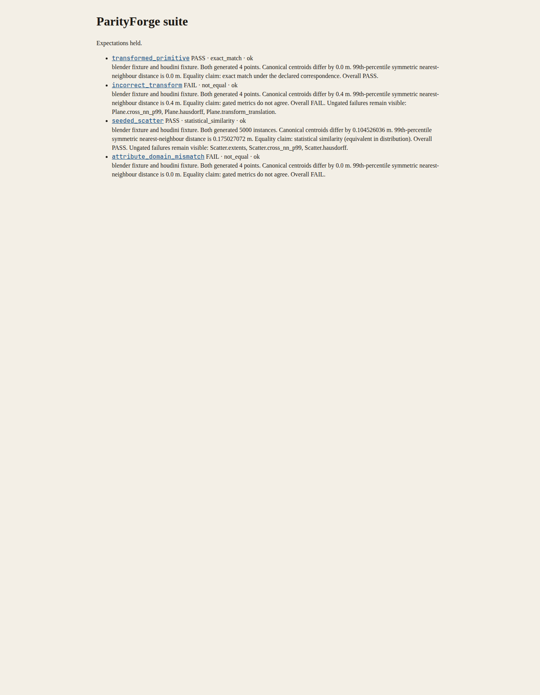
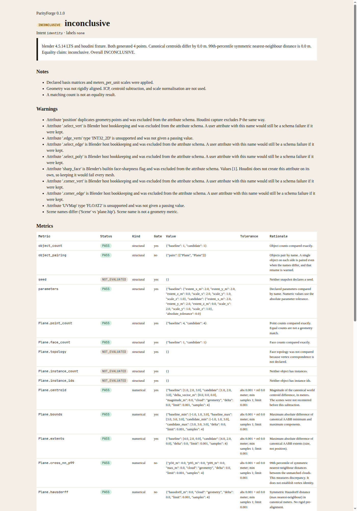

# ParityForge

ParityForge measures whether equivalent procedural setups in Blender and Houdini actually evaluate to the same geometry. It is a verifier. It does not compile node trees, and it is not a substitute for [NodeBridge](https://github.com/Plygonality/NodeBridge).

A report can say: both sides generated 5,000 instances, the canonical centroids differ by a measured distance, the 99th-percentile symmetric nearest-neighbour distance is larger than a vertex tolerance, and the equality claim is statistical similarity. Matching counts are never treated as equality.

[](https://github.com/Plygonality/ParityForge/actions/workflows/ci.yml)
[](LICENSE)

The CI badge is the GitHub Actions workflow in this repository. It is not a coverage percentage or a star count.

## Five-minute demo

Requirements: Python 3.11 or newer. Blender and Houdini are optional. This demo does not need either one, and it does not call an LLM.

```bash
python -m pip install -e ".[dev]"
parityforge doctor
parityforge validate fixtures/transformed_primitive/blender.snapshot.json
parityforge compare \
  fixtures/transformed_primitive/blender.snapshot.json \
  fixtures/transformed_primitive/houdini.snapshot.json \
  --config fixtures/transformed_primitive/parityforge.toml \
  --out reports/plane
parityforge suite fixtures/suite.yaml --out reports/suite
```

Open `reports/suite/index.html`.

What the authored suite is built to show:

| Case | Result |
| --- | --- |
| Transformed primitive | `PASS`, equality claim `exact_match`. Houdini stores the same plane in Y-up centimeters, including a non-uniform scale of 2 on X. Canonical centroid is `(1, 2, 3)` m and the delta is 0. |
| Incorrect transform | `FAIL`. Same plane, plus 40 cm on Houdini X. Centroids differ by 0.4 m. Point count and surface area still pass, so a count match cannot hide the offset. |
| Seeded scatter | `PASS`, labels `equivalent_in_distribution`. Both sides declare seed 42 and 5,000 instances. Positions come from different streams. Vertex identity is `NOT_EVALUATED`. The summary includes the measured centroid delta and the 99th-percentile nearest-neighbour distance, and it lists the ungated Hausdorff failure. |
| Attribute domain | `FAIL`. `mask` is a point attribute on one side and a face attribute on the other. Values are not interpolated. |

`expect` in `fixtures/suite.yaml` is checked after the verdict. Editing it does not make a comparison pass.

## Install

```bash
python -m pip install -e ".[dev]"
```

Runtime dependencies are numpy, scipy, pydantic, and PyYAML. HTML reports use the standard library. Offline `compare`, `validate`, and `suite` run on Windows, macOS, and Linux without a DCC.

## Capture, when a DCC is installed

Doctor prints these commands. They are the ones the scripts implement (`--help` shows the same flags):

```bash
blender --background scene.blend --python scripts/capture_blender.py -- --out snapshots/scene.snapshot.json
hython scripts/capture_houdini.py --hip scene.hip --node /obj/geo1/OUT --out snapshots/scene.snapshot.json
```

The Blender `--` is required. Official Blender builds ship numpy and a private Python, and they do not ship pydantic. Install that package into Blender's interpreter (a `pip install` on `PATH` does not reach `blender --python`):

```bash
python tools/install_blender_host_deps.py --blender "$(command -v blender)"
```

A demo plane, for a machine that has Blender 3.6 or newer:

```bash
blender --background --factory-startup --python scripts/blender_demo.py -- --out snapshots/blender_demo.snapshot.json
```

Houdini 19.5 or newer, only under hython:

```bash
hython scripts/houdini_demo.py --out snapshots/houdini_demo.snapshot.json
```

If `hython` is missing or cannot import `hou`, the Houdini lane is `NOT_RUN`. Doctor will not invent a version. Unreal capture is deferred; see [docs/unreal_v0.2.md](docs/unreal_v0.2.md).

## Commands

```bash
parityforge validate fixtures/transformed_primitive/blender.snapshot.json
parityforge compare snapshots/blender.json snapshots/houdini.json \
  --config parityforge.toml --out reports/plane
parityforge suite fixtures/suite.yaml --out reports/suite
parityforge doctor
```

Compare exit codes: `0` PASS, `1` FAIL, `2` INCONCLUSIVE, `3` validation or usage error. Suite exits `1` when a case disagrees with its expectation.

## How a verdict is chosen

Snapshots declare units and a basis matrix. ParityForge converts both into a right-handed Z-up meter frame using that declaration. It does not run ICP, subtract centroids first, or normalize scale.

Identity comparisons require explicit index correspondence before per-vertex positions can pass. Distribution comparisons can pass when the clouds occupy the same region and have similar nearest-neighbour statistics, and the report says `statistical_similarity` rather than vertex identity.

Statuses are `PASS`, `FAIL`, `INCONCLUSIVE`, `UNSUPPORTED`, and `NOT_EVALUATED`. An unavailable metric is `NOT_EVALUATED`, never a quiet pass. Image comparison is `UNSUPPORTED` in v0.1.

Details: [docs/architecture.md](docs/architecture.md), [docs/schema.md](docs/schema.md), [docs/gap_audit.md](docs/gap_audit.md), [docs/limitations.md](docs/limitations.md), [docs/troubleshooting.md](docs/troubleshooting.md).

## Development

```bash
python -m pytest
ruff check src tests tools scripts
python tools/build_fixtures.py
```

Fixtures are regenerated from `src/parityforge/authoring.py`. The Houdini centimeter coordinates in the transformed-plane fixture are the hand mapping `(x, y, z) → (x, z, -y)` times 100, and a test locks those numbers.

## Verification

* Offline unit tests and the fixture suite cover schema rejection, hash mismatches, Blender/Houdini/Unreal basis math, non-unit scale, exact pass, threshold pass, threshold fail, and inconclusive sample counts.
* The Blender and Houdini capture modules are executed against fakes in unit tests. A fake is not a DCC session.
* A live Blender 4.5.14 LTS capture (hash `62c1db4208e8`, built 2026-09-15) ran `scripts/blender_demo.py`. Doctor reported `Blender 4.5.14 LTS`. The evaluated plane matched the authored Houdini centimeter snapshot on point count, face count, centroid `(1, 2, 3)` m, surface area 8 m², Hausdorff distance, bounds, and canonical extents/scales. Vertex identity stayed `NOT_EVALUATED` because the capture writes `correspondence = none`. Under `fixtures/parityforge.toml` the overall verdict is `INCONCLUSIVE` for that reason, with `parameters` PASS. That check is `tests/test_live_dcc.py`. CI downloads the same Blender build (sha256 pinned in `.github/workflows/ci.yml`), installs pydantic into its Python, and requires the test.

Screenshots below are from those commands in this environment (`parityforge suite fixtures/suite.yaml` and the live Blender compare). They are HTML reports, not DCC viewports.




* The Houdini live test runs only when hython imports. Otherwise it is skipped and `tools/host_lane_status.py` reports `NOT_RUN`. v0.1 was not verified in a licensed Houdini session. No hython binary was present.
* No Unreal results are claimed.

## License

MIT. See [LICENSE](LICENSE).
